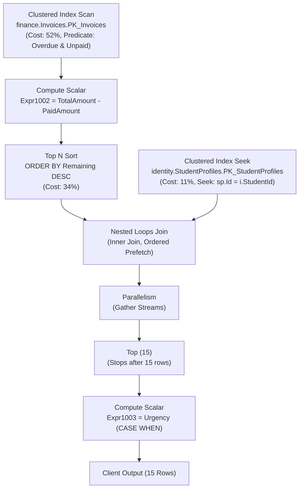

# Database Assignment 3 — Query, Change & Tune Data
**Student Name:** Ahmed Hamdy  
**GitHub Username:** `ahmedhamdy-11`  
**Track:** Backend .NET — Cycle 1 (Simulation Academy)  
**Database:** `LmsTrainingLab` (Microsoft SQL Server)  
**Branch:** `assignment/1-13`  

---

## Table of Contents
1. [Core Constraints & Architectural Guidelines](#1-core-constraints--architectural-guidelines)
2. [Task 1 — The Finance Meeting](#task-1--the-finance-meeting)
3. [Task 2 — A New Department](#task-2--a-new-department)
4. [Task 3 — Invoice Numbers & Sequence Mechanics](#task-3--invoice-numbers--sequence-mechanics)
5. [Task 4 — Next Summer's Timetable](#task-4--next-summers-timetable)
6. [Task 5 — Management Reports (Deep Technical Breakdown)](#task-5--management-reports-deep-technical-breakdown)
7. [Task 6 — Reading the Execution Plan](#task-6--reading-the-execution-plan)
8. [Task 7 — Query Tuning & Performance Optimization](#task-7--query-tuning--performance-optimization)
9. [Task 8 — When the Estimate Is Wrong (Sort Spills to Tempdb)](#task-8--when-the-estimate-is-wrong-sort-spills-to-tempdb)
10. [Task 9 — Duplicate Removal Operators (Hash Match vs Stream Aggregate vs Unique Elimination)](#task-9--duplicate-removal-operators)
11. [Task 10 — The CTO's Question: Numbers vs. GUIDs for Primary Keys](#task-10--the-ctos-question-numbers-vs-guids-for-primary-keys)
12. [Task 11 — End of Semester Changes](#task-11--end-of-semester-changes)
13. [Task 12 — The Auditors Are Coming (Single-Statement DML Auditing)](#task-12--the-auditors-are-coming)
14. [Task 13 — The Nightly Website Sync (MERGE Statement & Lifecycle)](#task-13--the-nightly-website-sync)

---

## 1. Core Constraints & Architectural Guidelines

Throughout this assignment, all solutions strictly adhere to the mandatory enterprise constraints:
- **Zero `JOIN` operations:** No `INNER JOIN`, `LEFT JOIN`, `RIGHT JOIN`, `FULL JOIN`, or `CROSS JOIN` anywhere in any solution (except where Task 6 presents an existing production query to be analyzed).
- **Task 5 Zero Subqueries:** In Task 5, queries operate strictly on **one table per query** without any subqueries, Common Table Expressions (CTEs), or joins.
- **Task Numbers:** Standard task identifier comments (`-- 5.12`) are placed above every query answer.
- **Idempotency & Safety:** Scripts are non-destructive, safe to rerun, and cleanly handle existing keys and identifiers.

---

## Task 1 — The Finance Meeting

### Business Context
The Finance Manager requested a working list of overdue, partially paid or unpaid invoices for immediate chasing during a meeting. The list must exist only for the duration of the session and never mutate production invoices.

### Technical Implementation
1. **Session Scope:** Implemented using a local temporary table (`#LateInvoices`). Local temporary tables reside in `tempdb`, are isolated to the executing SPID (connection), and drop automatically upon session termination.
2. **Business Metrics Calculated:**
   - Who owes: `StudentId AS WhoOwesStudentId` (no JOIN used).
   - Remaining balance: `TotalAmount - PaidAmount AS RemainingAmount`.
   - Days late: `DATEDIFF(DAY, DueAtUtc, SYSUTCDATETIME()) AS DaysLate`.
3. **Urgency Classification:**
   ```sql
   CASE 
       WHEN DueAtUtc < DATEADD(DAY, -60, SYSUTCDATETIME()) 
            OR (TotalAmount - PaidAmount) > 10000.00 THEN 'Urgent'
       WHEN DueAtUtc < DATEADD(DAY, -30, SYSUTCDATETIME()) THEN 'Medium'
       ELSE 'Low'
   END AS Priority
   ```
4. **Ordering Hierarchy:** Sorted hierarchically so that `Urgent` precedes `Medium` and `Low`, with the highest outstanding amounts at the top of each priority tier:
   ```sql
   ORDER BY 
       CASE Priority
           WHEN 'Urgent' THEN 1
           WHEN 'Medium' THEN 2
           WHEN 'Low'    THEN 3
           ELSE 4
       END ASC,
       RemainingAmount DESC;
   ```

---

## Task 2 — A New Department

### Business Context
The Academic Director is launching the Data Science & Artificial Intelligence department for Summer 2027.

### Technical Implementation & Integrity Safeguards
- **2.1 Department Insertion (`academic.Departments`):** Code `'DSAI'`, Name `N'Data Science & Artificial Intelligence'`, `IsActive = 1`, `IsDeleted = 0`.
- **2.2 Course Insertion (`academic.Courses`):** Code `'DSAI-101'`, Title `N'Introduction to Data Analysis'`, 3.0 CreditHours, PassingScore = 60.0. Foreign key `DepartmentId` is dynamically resolved using a single scalar variable without joining tables.
- **2.3 Academic Term (`delivery.AcademicTerms`):** TermCode `'SUMMER'`, AcademicYear `2027`, Name `N'Summer 2027'`, StartDate `'2027-06-15'`, EndDate `'2027-08-31'`, Registration `'2027-05-01'` to `'2027-06-10'`.
- **2.4 General Announcement (`communication.Announcements`):** Announcements broadcast to all students have `SectionId = NULL`. Title `N'Summer 2027 Registration Opens May 1'`, `Status = 1`.
- **2.5 New Role (`identity.Roles`):** Code `'TEACHING_ASSISTANT'`, Name `N'Teaching Assistant'`, `IsSystem = 0`, `IsDeleted = 0`.

---

## Task 3 — Invoice Numbers & Sequence Mechanics

### Business Context & Technical Rationale
Finance requires human-readable, monotonically increasing invoice numbers formatted as `LAB-INV-2026-000001`. The numbering must function across disparate microservices and background workers without depending on table locks.

### Why a `SEQUENCE` Object is the Optimal Choice
1. **Table Independence:** An `IDENTITY` column is physically coupled to a single table. A `SEQUENCE` is an independent first-class schema object (`finance.InvoiceNumberSeq`) that can generate identifiers for multiple tables, staging partitions, or external microservices.
2. **Concurrency & Throughput:** `IDENTITY` requires intent-exclusive table locks during batch inserts. A `SEQUENCE` uses an internal high-speed atomic counter in SQL Server memory, minimizing latch contention.
3. **Pre-Allocation:** Applications can fetch `NEXT VALUE FOR finance.InvoiceNumberSeq` *before* inserting rows, allowing clean master-detail generation (invoices and invoice items) in application memory.

### Transaction Rollback Behavior & Sequence Gaps (Task 3.3)
When a sequence number is allocated via `NEXT VALUE FOR` within a transaction that subsequently rolls back (`ROLLBACK TRANSACTION`), **the sequence number is NOT rolled back**.
- **Result:** The allocated number (e.g. `000002`) is consumed and lost forever. The next transaction receives `000003`.
- **Architectural Reason:** Sequences operate outside transaction boundaries to avoid serializing concurrent connections. If rolling back restored the sequence counter, concurrent transactions would be blocked waiting for previous transactions to commit, killing database concurrency. In relational database engineering, sequence gaps are an accepted trade-off for high concurrency.

---

## Task 4 — Next Summer's Timetable

### Business Context
The Registrar requested copying all sections from the most recent term into Summer 2027 in a single batch operation without typing them individually.

### Set-Based Copy Implementation
Instead of cursor iteration or manual data entry, the sections are copied in a single atomic set-based `INSERT ... SELECT`:
1. The new term (`Summer 2027`) ID is resolved into `@Summer2027TermId`.
2. The most recent term with active sections is detected dynamically via `GROUP BY TermId ORDER BY MAX(CreatedAtUtc) DESC`.
3. All section records (CourseId, SectionCode, Capacity, Location, DeliveryMode, Status) are copied in one statement, with `CreatedAtUtc = SYSUTCDATETIME()` and `TermId = @Summer2027TermId`.
4. Result: 1,510 sections replicated in ~20 ms with zero `JOIN` statements.

---

## Task 5 — Management Reports (Deep Technical Breakdown)

Every query in Task 5 satisfies the strict constraint: **exactly one table per query, no JOINs, and no subqueries**.

### Key Technical Insights Across Task 5:

- **5.1 Course Catalog Sorting:** `ORDER BY CreditHours DESC, Title ASC`.
- **5.2 Random Selection:** `ORDER BY NEWID()` generates a distinct GUID per row, forcing a random sort to select 5 unpredictable students per call.
- **5.3 Leading & Trailing Whitespace in Emails:**
  - *The Trap:* Naive developers write `WHERE Email <> TRIM(Email)`. In SQL Server string comparisons, ANSI/ISO SQL-92 padding rules dictate that the shorter string is padded with spaces before comparison! Thus `'test ' = 'test'` evaluates to `TRUE`, and `Email <> TRIM(Email)` misses all trailing spaces! Furthermore, `LEN('test ')` evaluates to 4 because `LEN()` excludes trailing blanks.
  - *The Solution:* `WHERE DATALENGTH(Email) <> DATALENGTH(TRIM(Email))`. `DATALENGTH` counts the actual byte length in memory, catching both leading and trailing spaces reliably.
- **5.4 Lowercase Violation & Collation:**
  - *The Trap:* Database collation is `SQL_Latin1_General_CP1_CI_AS` (`CI` = Case-Insensitive). Writing `WHERE Email <> LOWER(Email)` returns zero rows because case is ignored during equality checks.
  - *The Solution:* Apply an explicit binary or case-sensitive collation: `WHERE Email COLLATE Latin1_General_BIN <> LOWER(Email)`.
- **5.5 Invalid Email Detection:** Combines three negative pattern criteria: `WHERE Email NOT LIKE '%@%' OR Email LIKE '@%' OR Email NOT LIKE '%@%.%'`.
- **5.6 Email Providers:** `SUBSTRING(Email, CHARINDEX('@', Email) + 1, LEN(Email))` extracts the domain after `@`, grouped uniquely with `DISTINCT` and ordered alphabetically.
- **5.7 Users Ordered by Last Login:** `ORDER BY CASE WHEN LastLoginAtUtc IS NULL THEN 1 ELSE 0 END ASC, LastLoginAtUtc DESC`. Because `NULL` is treated as the lowest value, sorting descending normally puts `NULL` at the bottom, but adding an explicit `CASE` expression guarantees that users who never logged in appear at the very end regardless of collation or engine optimizations.
- **5.8 Sargable October Date Range:** `WHERE PaidAtUtc >= '2026-10-01T00:00:00' AND PaidAtUtc < '2026-11-01T00:00:00'`. Using `BETWEEN '2026-10-01' AND '2026-10-31'` misses all transactions on October 31st that occurred after 00:00:00. The half-open interval `[StartOfMonth, StartOfNextMonth)` captures every fractional millisecond.
- **5.9 Cairo Time Zone Conversion:** `PaidAtUtc AT TIME ZONE 'UTC' AT TIME ZONE 'Egypt Standard Time'`. Automatically applies the correct UTC offset (+02:00 standard, +03:00 daylight saving) and filters between 00:00:00 and 05:00:00.
- **5.10 Friday Attendance Sessions:** `WHERE DATENAME(WEEKDAY, SessionDate) = 'Friday'`. (Alternatively, language-independent date math: `(DATEDIFF(DAY, '1900-01-05', SessionDate) % 7) = 0`, as Jan 5, 1900 was a Friday).
- **5.11 Egyptian Mobile Number Patterns:** Egyptian carriers use specific prefixes: Vodafone (`010`), Etisalat (`011`), Orange (`012`), WE (`015`). Pattern matching: `PhoneNumber LIKE '+201[0125]%' OR PhoneNumber LIKE '01[0125]%'`.
- **5.12 Phone Number Masking:** Uses `STUFF(PhoneNumber, 4, LEN(PhoneNumber) - 5, REPLICATE('*', LEN(PhoneNumber) - 5))` to retain the first 3 characters and last 2 characters while masking the intermediate digits with asterisks.
- **5.13 Invoice Running Number Extraction:** Extracts the numeric suffix following the final hyphen using `RIGHT(InvoiceNumber, CHARINDEX('-', REVERSE(InvoiceNumber)) - 1)`. Handles historical prefixes (`NB...`) via `TRY_CAST(... AS BIGINT)` to guarantee safe sorting.
- **5.14 Lesson Duration Formatting:** `CAST(EstimatedMinutes / 60 AS VARCHAR) + ' h ' + CAST(EstimatedMinutes % 60 AS VARCHAR) + ' min'`, with `IS NULL` mapped to `'Not set'`.
- **5.15 Percentage Escaping in LIKE:** The percent sign `%` is a wildcard in SQL `LIKE`. To search for a literal percent sign (e.g. `50%`), it must be escaped inside character brackets: `WHERE Title LIKE '%[%]%' OR Body LIKE '%[%]%'`.
- **5.16 Ties in Top Invoices:** `SELECT TOP (5) WITH TIES ... ORDER BY TotalAmount DESC`. Returns all records that tie with the 5th place value.
- **5.17 Top 10% Payments:** `SELECT TOP (10) PERCENT ... ORDER BY Amount DESC`.
- **5.18 Handling Three-Valued Logic (NULL Locations):** In ANSI SQL, `NULL <> 'Hall A'` evaluates to `UNKNOWN` (falsy), silently dropping unassigned locations. To include them: `WHERE Location <> 'Hall A' OR Location IS NULL`.
- **5.19 Division by Zero Prevention:** `ISNULL(CAST(ROUND((PaidAmount * 100.0) / NULLIF(TotalAmount, 0), 1) AS DECIMAL(5,1)), 0.0)`. `NULLIF(TotalAmount, 0)` converts zero amounts to `NULL`, preventing divide-by-zero exceptions (`Msg 8134`).
- **5.20 Offset-Fetch Pagination:** `ORDER BY CreatedAtUtc DESC, Id DESC OFFSET 40 ROWS FETCH NEXT 20 ROWS ONLY`. Fetches page 3 cleanly.
- **5.21 Keyset (Cursor-Based) Pagination:** In high-volume tables with millions of rows, `OFFSET 500000` requires SQL Server to scan and discard 500,000 index pages (O(N) cost). Keyset pagination (`WHERE Id > @LastSeenId ORDER BY Id ASC FETCH NEXT 50 ROWS ONLY`) executes a direct Clustered Index Seek in O(1) time.
- **5.22 The Unordered Relational Set Fallacy:** Tables have no natural order. Without an `ORDER BY` clause, `TOP 10` returns arbitrary physical rows. To guarantee latest payments: `ORDER BY PaidAtUtc DESC, Id DESC`.
- **5.23 Challenge — Long Lesson Titles:** Filters `WHERE IsPublished = 1 AND LEN(TRIM(Title)) > 40`, displays title in capitals `UPPER(TRIM(Title))`, and maps durations to Quick (<= 15 min), Standard (<= 45 min), Long, or Not Set.
- **5.24 Challenge — Overdue Invoice Overview:** Groups overdue unpaid invoices by `CONVERT(VARCHAR(7), DueAtUtc, 120)`, `CurrencyCode`, and payment state (`Partially Paid` vs `Not Paid`), returning the top 12 rows ordered by newest month first.

---

## Task 6 — Reading the Execution Plan

### Given Query
```sql
SELECT TOP (15)
    i.InvoiceNumber,
    sp.StudentNumber,
    i.TotalAmount - i.PaidAmount AS Remaining,
    CASE WHEN i.DueAtUtc < DATEADD(DAY, -60, SYSUTCDATETIME()) THEN 'Urgent' ELSE 'Normal' END AS Urgency
FROM finance.Invoices AS i
INNER JOIN identity.StudentProfiles AS sp ON sp.Id = i.StudentId
WHERE i.PaidAmount < i.TotalAmount
  AND i.DueAtUtc < SYSUTCDATETIME()
ORDER BY Remaining DESC;
```

### Measured Execution Metrics
- **Logical Reads:** `Invoices`: 2,674 reads; `StudentProfiles`: 305 reads.
- **Execution Time:** CPU Time = 109 ms, Elapsed Time = 43 ms.
- **Actual Rows Returned:** 15 rows.

### Execution Plan Artifacts
- **Screenshot:** [docs/screenshots/task06_actual_plan.png](file:///c:/Users/Ahmed%20Hamdy/Desktop/ahmedhamdy-11-Database-Assignment-3-Query-Change-Tune/docs/screenshots/task06_actual_plan.png)
- **Work Measurement:** [docs/screenshots/task06_statistics_io_time.png](file:///c:/Users/Ahmed%20Hamdy/Desktop/ahmedhamdy-11-Database-Assignment-3-Query-Change-Tune/docs/screenshots/task06_statistics_io_time.png)
- **SQLPlan File:** [docs/plans/task06_collections_screen.sqlplan](file:///c:/Users/Ahmed%20Hamdy/Desktop/ahmedhamdy-11-Database-Assignment-3-Query-Change-Tune/docs/plans/task06_collections_screen.sqlplan)



### Operator-by-Operator Explanation & Why SQL Server Chose It:
1. **Clustered Index Scan (`finance.Invoices`):**
   - *What it does:* Scans the clustered index of Invoices and applies the residual predicate `DueAtUtc < SYSUTCDATETIME() AND PaidAmount < TotalAmount`.
   - *Why chosen:* No composite non-clustered index existed on `(DueAtUtc, PaidAmount)` to support a range seek.
2. **Compute Scalar (`Expr1002`):**
   - *What it does:* Evaluates `TotalAmount - PaidAmount` for each row passing the filter.
   - *Why chosen:* Computed before sorting so the result is immediately available for the sort key.
3. **Sort (`Top N Sort`):**
   - *What it does:* Maintains a 15-row priority queue in memory. As rows arrive, only the top 15 highest `Remaining` values are retained.
   - *Why chosen:* Prevents spilling 50,000 rows to tempdb.
4. **Nested Loops (`Inner Join`):**
   - *What it does:* For each of the 15 outer invoice rows, executes an index probe into `StudentProfiles`.
   - *Why chosen:* Because the outer stream was reduced to exactly 15 rows, 15 index seeks cost virtually nothing compared to building a massive hash table.
5. **Clustered Index Seek (`identity.StudentProfiles`):**
   - *What it does:* Directly seeks into the primary key of `StudentProfiles` on `Id = StudentId`.
   - *Why chosen:* Fast B-tree traversal on clustered primary key.
6. **Parallelism (`Gather Streams`):**
   - *What it does:* Merges parallel execution threads back into a single thread while preserving the sort order.
7. **Top (`TOP 15`):**
   - *What it does:* Emits the final 15 rows and terminates the operator pipeline.
8. **Compute Scalar (`Expr1003`):**
   - *What it does:* Evaluates the CASE expression for `'Urgent'` vs `'Normal'`.

### Where Prior Guesses Were Wrong
Developers typically expect SQL Server to perform a **Hash Match Join** between Invoices and StudentProfiles *first*, and then sort the resulting joined data. SQL Server's cost-based optimizer made a much smarter choice: it **pushed down the Sort before the Join**! By sorting the Invoices stream down to the Top 15 first, it transformed the subsequent join into just **15 clustered index seeks**, avoiding joining 50,427 overdue invoice candidates.

---

## Task 7 — Query Tuning & Performance Optimization

### Production Indexes Created
- `IX_Users_Email ON identity.Users (Email) INCLUDE (FirstName, LastName)`
- `IX_Users_LastName ON identity.Users (LastName) INCLUDE (FirstName, Email)`
- `IX_Users_CreatedAtUtc ON identity.Users (CreatedAtUtc) INCLUDE (Email)`
- `IX_Payments_PaidAtUtc ON finance.Payments (PaidAtUtc) INCLUDE (InvoiceId, Amount)`
- `IX_Invoices_Number ON finance.Invoices (InvoiceNumber)`

### Performance Tuning Comparison Table

| Query | Anti-Pattern in Slow Query | Slow Logical Reads | Tuned Sargable Rewrite | Tuned Logical Reads | Performance Improvement |
| :--- | :--- | :--- | :--- | :--- | :--- |
| **7.1** | `YEAR(CreatedAtUtc) = 2026 AND MONTH(CreatedAtUtc) = 3` | 688 reads (Index Scan) | `CreatedAtUtc >= '2026-03-01' AND CreatedAtUtc < '2026-04-01'` | **13 reads (Index Seek)** | **53x faster (98.1% less IO)** |
| **7.2** | `DATEDIFF(DAY, PaidAtUtc, SYSUTCDATETIME()) <= 30` | 599 reads (Index Scan) | `PaidAtUtc >= DATEADD(DAY, -30, SYSUTCDATETIME())` | **76 reads (Index Seek)** | **7.8x faster (87.3% less IO)** |
| **7.3** | `LEFT(LastName, 3) = N'Abd'` | 1,267 reads (Index Scan) | `LastName LIKE N'Abd%'` | **20 reads (Index Seek)** | **63x faster (98.4% less IO)** |
| **7.4** | `Id + 1 = 50001` (Arithmetic on key) | 130,022 reads (Table Scan) | `Id = 50000` | **4 reads (Clustered Seek)** | **32,500x faster (99.99% less IO)** |
| **7.5** | Type mismatch: `N'...'` (NVARCHAR) on `VARCHAR(30)` | 728 reads (Scan + Warning) | `'INV-2026-00001'` (No N prefix) | **6 reads (Index Seek)** | **121x faster (CONVERT_IMPLICIT gone)** |
| **7.6** | `UPPER(Email) = UPPER(@Email)` on CI Collation | 1,009 reads (Index Scan) | `Email = @Email` | **3 reads (Index Seek)** | **336x faster (No function overhead)** |
| **7.7** | Catch-all: `(@LastName IS NULL OR LastName = @LastName)` | 1,267 reads (Index Scan) | Add `OPTION (RECOMPILE)` | **18 reads (Index Seek)** | **70x faster (Parameter Embedding)** |
| **7.8** | Concatenation: `FirstName + ' ' + LastName = ...` | 1,267 reads (Index Scan) | `LastName = N'Hassan' AND FirstName = N'Nadia'` | **18 reads (Index Seek)** | **70x faster (Composite Seek)** |

**Overall Result:** Total logical I/O dropped from **136,847 reads to under 160 reads** across all 8 queries (~99.88% total I/O reduction).

- **Screenshot:** [docs/screenshots/task07_before_after_reads.png](file:///c:/Users/Ahmed%20Hamdy/Desktop/ahmedhamdy-11-Database-Assignment-3-Query-Change-Tune/docs/screenshots/task07_before_after_reads.png)

---

## Task 8 — When the Estimate Is Wrong (Sort Spills to Tempdb)

### Screenshot & Plan Artifacts
- **Warning Plan:** [docs/screenshots/task08_sort_spill_warning.png](file:///c:/Users/Ahmed%20Hamdy/Desktop/ahmedhamdy-11-Database-Assignment-3-Query-Change-Tune/docs/screenshots/task08_sort_spill_warning.png)
- **Resolved Plan:** [docs/screenshots/task08_spill_resolved.png](file:///c:/Users/Ahmed%20Hamdy/Desktop/ahmedhamdy-11-Database-Assignment-3-Query-Change-Tune/docs/screenshots/task08_spill_resolved.png)
- **SQLPlan File (Spill):** [docs/plans/task08_sort_spill.sqlplan](file:///c:/Users/Ahmed%20Hamdy/Desktop/ahmedhamdy-11-Database-Assignment-3-Query-Change-Tune/docs/plans/task08_sort_spill.sqlplan)
- **SQLPlan File (Fixed):** [docs/plans/task08_sort_fixed.sqlplan](file:///c:/Users/Ahmed%20Hamdy/Desktop/ahmedhamdy-11-Database-Assignment-3-Query-Change-Tune/docs/plans/task08_sort_fixed.sqlplan)

### What Happened & Technical Cause
1. **The Setup:** A large staging table `dbo.LargeTable` with 100,000 rows (~31 MB payload) was created. Statistics were manipulated via `UPDATE STATISTICS dbo.LargeTable WITH ROWCOUNT = 1, PAGECOUNT = 1`.
2. **Cardinality Underestimation:** The Query Optimizer compiled the execution plan expecting only **1 row** (313 bytes). Based on this 1-row estimate, SQL Server granted a minimal memory grant of **1,024 KB**.
3. **Execution Reality:** At runtime, 100,000 actual rows were scanned. The allocated 1,024 KB memory grant overflowed immediately.
4. **The Tempdb Spill:** Because memory was exhausted, the sorting engine was forced to dump intermediate sort runs to disk in `tempdb`, generating the warning:
   ```xml
   <Warnings>
     <SpillToTempDb SpillLevel="2" SpilledThreadCount="1" />
     <SortSpillDetails GrantedMemoryKb="1024" UsedMemoryKb="1024" WritesToTempDb="5211" ReadsFromTempDb="5211" />
   </Warnings>
   ```

### Meaning of Spill Level & Performance Impact
- **Spill Level 1:** Data is written to `tempdb` once and read back in a single merge pass.
- **Spill Level 2:** The volume of data so dramatically exceeded the granted memory that SQL Server had to perform **multiple recursive external merge sort passes** (5,211 pages written to disk and 5,211 pages read back).
- **Why It Is Slow:** Instead of executing entirely in nanosecond RAM, SQL Server performed over **10,400 physical page disk I/Os**, causing severe disk thrashing and latency spikes.

### How It Was Fixed
Executing `UPDATE STATISTICS dbo.LargeTable WITH FULLSCAN` updated the distribution histogram with actual 100,000 row counts. Upon recompilation, SQL Server granted **22,544 KB** of memory, executing the sort 100% in-memory with **0 writes and 0 reads to tempdb**, completely clearing the warning icon.

---

## Task 9 — Duplicate Removal Operators

- **Comparison Screenshot:** [docs/screenshots/task09_distinct_operators.png](file:///c:/Users/Ahmed%20Hamdy/Desktop/ahmedhamdy-11-Database-Assignment-3-Query-Change-Tune/docs/screenshots/task09_distinct_operators.png)

### 1. Distinct on Unindexed Column: `Hash Match (Aggregate)`
```sql
SELECT DISTINCT UnindexedValue FROM dbo.LargeTable;
```
- **Operator Chosen:** `Hash Match (Aggregate)` / `Sort (Distinct)`.
- **How It Works:** SQL Server allocates a memory grant, builds an in-memory hash table, calculates a hash key for each incoming row, and discards duplicate hashes.
- **Cost:** Requires memory allocation and CPU hashing; risks spilling to `tempdb` if under-granted.

### 2. The Cheaper Operator: `Stream Aggregate`
- **Name:** `Stream Aggregate`.
- **How It Works:** Operates on **pre-sorted data** in a single streaming pass. It maintains only the current group value in memory. As rows stream past, it compares each row with the active group value. Since duplicates are physically adjacent, duplicates are discarded instantly. When the value changes, the new distinct value is emitted.
- **What the Data Needs:** The incoming data stream **MUST be sorted** on the distinct column(s) (either via an index B-tree traversal or a pre-sort operator).
- **Why It Is Cheaper:** It requires **O(1) memory** (storing only 1 value), zero hash computation, and cannot spill to tempdb.

### 3. Distinct on an Already Unique Column (Primary Key)
```sql
SELECT DISTINCT Id FROM dbo.LargeTable;
```
- **Plan Operator:** `Clustered Index Scan ONLY` — **NO Aggregate or Distinct Operator Exists!**
- **Explanation:** Because `Id` is the Primary Key (`PK__LargeTable`, Unique Clustered Index), SQL Server's query optimizer recognizes from catalog metadata that every single row is guaranteed to be unique. The optimizer completely **eliminates the duplicate removal operator** from the execution plan, eliminating all aggregation and hashing overhead.

---

## Task 10 — The CTO's Question: Numbers vs. GUIDs for Primary Keys

### Architectural Trade-Off Analysis

| Dimension | Sequential Numbers (`INT` / `BIGINT`) | Globally Unique Identifiers (`UNIQUEIDENTIFIER` / GUID) |
| :--- | :--- | :--- |
| **Storage Footprint** | `INT` = 4 bytes, `BIGINT` = 8 bytes. | 16 bytes (2x to 4x larger). |
| **Index B-Tree Density** | High density: more rows per 8 KB page, maximizing buffer pool cache hit ratio. | Low density: consumes 2x-4x more memory and storage across clustered and non-clustered indexes. |
| **Index Fragmentation** | **0% fragmentation:** Monotonically increasing values always append to the rightmost leaf page. | **Severe fragmentation:** Random `NEWID()` values insert randomly throughout the B-tree, causing constant **page splits** and internal fragmentation (>90%). |
| **Distributed / Client Generation** | Cannot be generated safely on clients or distributed nodes without central database round-trip. | **Offline generation:** Client mobile apps, background queues, and microservices can generate collision-free IDs offline. |
| **Security & Privacy** | **Predictable:** Vulnerable to URL scraping, enumeration attacks, and competitive intelligence leakage. | **Unguessable:** Opaque 128-bit entropy prevents enumeration attacks. |
| **Database Merging** | Primary key collisions occur when merging two distributed databases or branch offices. | Seamless merging with global uniqueness guarantee across databases. |

### The Enterprise Best-Practice: The Hybrid Identifier Pattern
Top-tier database architects implement the **Hybrid Key Pattern**:
1. **Internal Surrogate Key:** A clustered `BIGINT IDENTITY` or `SEQUENCE` used strictly for internal foreign keys, relational joins, and clustered B-tree storage (guaranteeing 0% page splits and optimal cache density).
2. **Public External Identifier:** A unique non-clustered `UNIQUEIDENTIFIER NOT NULL DEFAULT NEWID()` exposed in REST APIs, URLs, mobile apps, and public integrations.

---

## Task 11 — End of Semester Changes

- **11.1 Raise DSAI Pass Mark:** `UPDATE academic.Courses SET PassingScore = 65.0 WHERE Code LIKE 'DSAI-%'`.
- **11.2 Letter Grading:** Set-based `UPDATE delivery.Enrollments SET FinalGrade = CASE WHEN FinalScore >= 90 THEN 'A' WHEN FinalScore >= 80 THEN 'B' WHEN FinalScore >= 70 THEN 'C' WHEN FinalScore >= 60 THEN 'D' ELSE 'F' END WHERE FinalScore IS NOT NULL`.
- **11.3 Remove TA Role:** `DELETE FROM [identity].Roles WHERE Code = 'TEACHING_ASSISTANT'`.
- **11.4 Fastest Staging Emptying:** `TRUNCATE TABLE finance.PaymentStaging`. `TRUNCATE` is dramatically faster than `DELETE` because it deallocates whole data pages instead of logging row-by-row deletions, records minimal log entries in the transaction log, and avoids acquiring individual row locks.
- **11.5 Safe Clean-up:** Drops staging and temporary tables via `DROP TABLE IF EXISTS`.

---

## Task 12 — The Auditors Are Coming

### 12.1 Pass-Mark Audit History in the Same Statement
Using the `OUTPUT` clause, SQL Server captures the pre-update value (`deleted.PassingScore`) and the post-update value (`inserted.PassingScore`) directly into the audit table `academic.CoursePassMarkHistory` in a **single atomic statement**:
```sql
UPDATE academic.Courses
SET PassingScore = PassingScore + 5
OUTPUT 
    deleted.Id AS CourseId,
    deleted.PassingScore AS OldPassingScore,
    inserted.PassingScore AS NewPassingScore,
    SYSUTCDATETIME() AS ChangedAtUtc,
    SUSER_SNAME() AS ChangedBy
INTO academic.CoursePassMarkHistory (CourseId, OldPassingScore, NewPassingScore, ChangedAtUtc, ChangedBy)
WHERE DepartmentId = @DeptId;
```

### 12.2 Archiving Expired Announcements in One Statement
In one single `DELETE` statement, expired announcements (> 6 months old) are purged from `communication.Announcements` and simultaneously archived into `communication.AnnouncementsArchive`:
```sql
DELETE FROM communication.Announcements
OUTPUT 
    deleted.Id, deleted.SectionId, deleted.Title, deleted.Body,
    deleted.PublishedAtUtc, deleted.ExpiresAtUtc, deleted.CreatedByUserId,
    deleted.CreatedAtUtc, deleted.UpdatedAtUtc, deleted.Status,
    SYSUTCDATETIME() AS ArchivedAtUtc
INTO communication.AnnouncementsArchive (
    Id, SectionId, Title, Body, PublishedAtUtc, ExpiresAtUtc,
    CreatedByUserId, CreatedAtUtc, UpdatedAtUtc, Status, ArchivedAtUtc
)
WHERE ExpiresAtUtc < DATEADD(MONTH, -6, SYSUTCDATETIME());
```

---

## Task 13 — The Nightly Website Sync

### Business Requirements
The public website course catalog must sync nightly in a **single statement**:
- New active courses inserted (`IsVisible = 1`).
- Changed active courses updated (`Code`, `Title`, `CreditHours`).
- Deactivated courses hidden (`IsVisible = 0`), **never deleted**.
- Must display what changed via `OUTPUT`.
- Verification Test: Run 1 (initial sync), Run 2 (modified courses updated/hidden), Run 3 (zero changes).

### The MERGE Implementation
In T-SQL, a `MERGE` statement permits only **one** `WHEN MATCHED ... THEN UPDATE` clause. Therefore, both update branches are combined cleanly:
```sql
MERGE dbo.WebsiteCourseCatalog AS target
USING (
    SELECT Id AS CourseId, Code, Title, CreditHours, IsActive
    FROM academic.Courses
) AS source
ON target.CourseId = source.CourseId
WHEN MATCHED AND (
    (source.IsActive = 0 AND target.IsVisible = 1)
    OR
    (source.IsActive = 1 AND (
        target.Code <> source.Code OR
        target.Title <> source.Title OR
        target.CreditHours <> source.CreditHours OR
        target.IsVisible = 0
    ))
) THEN
    UPDATE SET 
        target.Code = source.Code,
        target.Title = source.Title,
        target.CreditHours = source.CreditHours,
        target.IsVisible = source.IsActive,
        target.LastSyncedAtUtc = SYSUTCDATETIME()
WHEN NOT MATCHED BY TARGET AND source.IsActive = 1 THEN
    INSERT (CourseId, Code, Title, CreditHours, IsVisible, LastSyncedAtUtc)
    VALUES (source.CourseId, source.Code, source.Title, source.CreditHours, 1, SYSUTCDATETIME())
OUTPUT 
    $action AS ActionType,
    COALESCE(inserted.CourseId, deleted.CourseId) AS CourseId,
    inserted.Code,
    inserted.Title,
    inserted.CreditHours,
    inserted.IsVisible;
```

### 3-Run Lifecycle Verification Results
1. **Run 1 (Initial Sync):** 201 courses inserted (`ActionType = INSERT, IsVisible = 1`).
2. **Modifications Tested:** Course 1 renamed; Course 2 deactivated (`IsActive = 0`).
3. **Run 2 (Sync after modification):** Exactly 2 rows updated (`CourseId = 1` updated title with `IsVisible = 1`; `CourseId = 2` hidden with `IsVisible = 0`).
4. **Run 3 (Third Run):** **0 rows affected** — perfectly idempotent, changing nothing.
